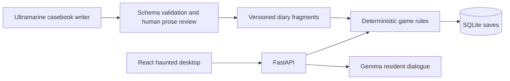

# The Last Process

**An abandoned desktop. One process still running.**

[Play the live game](https://the-last-process.onrender.com) · [Interactive API docs](https://the-last-process.onrender.com/docs) · [Source code](https://github.com/Reet24-del/the-last-process)

A short haunted-browser escape room about the difference between preserving a memory and keeping a machine waiting. Recover three files, speak to the resident, and decide how Mara's last process ends.

This is a new project, separate from Report Navigator. Everything in the desktop is fiction. It never accesses your files or executes terminal commands.

## Post-submission update — November 1, 2026

The cinematic frontend redesign was published after the contest cutoff (12:29 PM IST). It adds a spooky landing page, original observatory artwork, chat bubbles with saved conversation history, clearer typography, responsive layouts, reduced-motion support, and opt-in procedural ambient sound. The original game and DEV submission were already published before the cutoff. These visual and audio improvements are post-submission changes.

## Play

Play at **https://the-last-process.onrender.com**. The local build runs at **http://127.0.0.1:8010**. The public app runs on Render's free plan and may take a minute to wake after inactivity.

1. Read `boot.log` and find the returning signal.
2. Recover and decode `signal.txt`.
3. Unlock `archive.lock` and read `goodbye.txt`.

Ask the resident for help when stuck. Each request gives a progressively clearer, authored hint alongside optional Gemma dialogue. Sound is off by default. Both final choices close the listener.

## What the AI does

- **Gemma 4** (`gemma-4-26b-a4b-it`), hosted through Google's Gemini API, plays the resident and reacts to the current clue and your question. This uses Gemma, not a Gemini model. A server-only key is required for live dialogue.
- **Ultramarine** (`ultramarine-1-flash`) wrote the three validated diary fragments included in this build, without changing clues, answers, unlocks, or endings. The optional build-time writer records real token usage. See [live test evidence](docs/ULTRAMARINE_TEST.md). If a generated casebook is absent or invalid, the game falls back to the authored story and labels it accordingly.
- **Deterministic Python** validates answers and controls progression. Model output is never treated as a command or unlock instruction.

When a provider fails, the UI clearly labels the authored fallback. The authored hint remains available; there is no claim that a fallback was AI-generated. The complete puzzle game can run locally without an AI key. Live Gemma requires internet.

## Stack and architecture

| Component | Purpose |
| --- | --- |
| React + Vite | Responsive desktop, file reader, resident dialogue and game controls |
| FastAPI | Session, answer, hint and ending endpoints; interactive API docs |
| SQLite | Transactional game saves, opaque session tokens, bounded message history |
| Google Gen AI SDK | Server-side Gemma calls with a timeout and no hidden SDK retries |
| OpenAI SDK with Paper Instruments base URL | Optional Ultramarine casebook generation; it does not call OpenAI's models |
| Docker | Builds the web client and serves it from the same Python service |
| pytest + browser checks | Rule validation, API behavior, concurrency, resume and responsive gameplay |



```text
app/
  main.py            HTTP transport and service lifecycle
  content.py         Authored clues, answers, hints and endings
  game.py            Public views, progression and hint limits
  store.py           Transactional SQLite save store
  ghost.py           Bounded Gemma dialogue and honest fallback
  casebook.py        Validated optional story loading
scripts/
  generate_casebook.py  Ultramarine writing and usage ledger
web/
  src/               Small React components, API client and design tokens
  public/assets/     Original generated resident portrait and observatory scene
tests/               Game, API, provider and casebook tests
docs/                Submission draft and integration evidence
```

## Run locally

Requires Python 3.11+ and Node 22.12+.

```bash
python3 -m venv .venv
source .venv/bin/activate
pip install -r requirements-dev.txt
cp .env.example .env
# Optionally set GEMINI_API_KEY in .env. Never commit this file.
cd web
npm ci
npm run build
cd ..
uvicorn app.main:app --host 127.0.0.1 --port 8010 --no-access-log
```

For frontend development, run `npm run dev` in `web/` while the Python server runs on port 8010. Vite proxies `/api` to Python. Production uses a same-origin build and needs no browser API key or CORS setup.

## Generate a casebook with Ultramarine

```bash
pip install -r requirements-content.txt
# Add PAPERINSTRUMENTS_API_KEY to the local .env or .env.ultramarine, then:
python -m scripts.generate_casebook
```

Review `app/case.generated.json` before deployment. The command refuses to overwrite an existing casebook unless `--overwrite` is supplied. It makes one bounded call, validates exactly three fragments, and records provider token usage in `docs/ultramarine-runs.jsonl`. The recorded cost is a calculation from published rates, **not a settled billing receipt**; reconcile it against the provider console for the challenge submission. No automatic top-up or paid infrastructure is configured.

The generator uses the [official Ultramarine endpoint and model](https://docs.paperinstruments.com/docs/ultramarine), with [documented token pricing](https://docs.paperinstruments.com/docs/ultramarine/billing).

## API

Public Swagger UI: **https://the-last-process.onrender.com/docs**. Schema: **https://the-last-process.onrender.com/openapi.json**. The same paths are available locally at port 8010.

| Endpoint | Purpose |
| --- | --- |
| `GET /health` | Process health and configured model name; no provider call |
| `POST /api/sessions` | Create a game and receive its opaque token |
| `GET /api/session` | Resume with `Authorization: Bearer YOUR_SESSION_TOKEN` |
| `POST /api/answer` | Submit `{ "stage": 0, "answer": "..." }` |
| `POST /api/ghost` | Ask `{ "message": "Please give me a hint" }` |
| `POST /api/ending` | Choose `{ "choice": "release" }` or `"preserve"` after recovery |

The session token belongs in the HTTP header, not the URL. API responses disable caching. Do not share your token if you want your game private.

## Verify

```bash
python -m pytest tests -q
cd web
npm run format:check
npm run build
```

Tests cover incorrect and stale answers, concurrent duplicate submissions, all three puzzles, both endings, independent sessions, hint limits, API authentication and payload validation, provider failure, global call limits, invalid casebook fallback and cost calculation. Browser checks additionally exercise refresh/resume, restart confirmation and mobile layout.

## Deployment and limitations

The app is deployed as a free Docker web service on Render, matching `render.yaml`. A public end-to-end check verified live Gemma, the bundled Ultramarine diary, all three puzzles, an ending, resume, and Swagger. See [deployment evidence](docs/DEPLOYMENT.md). Set the server-only `GEMINI_API_KEY` in the host's secret environment variables for your own deployment. Never place it in a `VITE_` variable. Health path: `/health`.

- Free Render services can sleep. Their local disk is ephemeral: redeployment or restart may erase game saves. A persistent database is needed for durable production saves.
- Saves expire after 24 hours without activity; there are at most 500 stored sessions.
- Hint requests have a three-second session cooldown, a 20-call session limit and a 200-call process budget. Restarting the service resets the process budget. This is a small demo, not a billing-grade abuse prevention system.
- Google receives the player's ghost message and fictional clue only when the player asks for a hint. The server stores a bounded dialogue history alongside progress. Don't enter personal or confidential information.
- Prompt instructions are not a security boundary. AI dialogue can still be mistaken; puzzle progression is protected by deterministic code and an independently displayed authored hint.
- Ambient sound is synthesized in the browser. It is not ElevenLabs narration. No unverified sponsor integration is claimed.
- The generated ghost portrait was made with OpenAI ImageGen during development. UI controls and text are native HTML/CSS/React.

## Open innovation

Gemma's open weights make it possible to inspect the model family, replace the hosted runtime with a compatible local deployment, and keep the game rules independent of a closed provider. This build uses hosted inference; it does **not** bundle or run Gemma locally. See [Google's Gemma API documentation](https://ai.google.dev/gemma/docs/core/gemma_on_gemini_api).

Application code is MIT licensed. Dependencies and external models retain their own licenses and terms. The story and characters are fictional.
