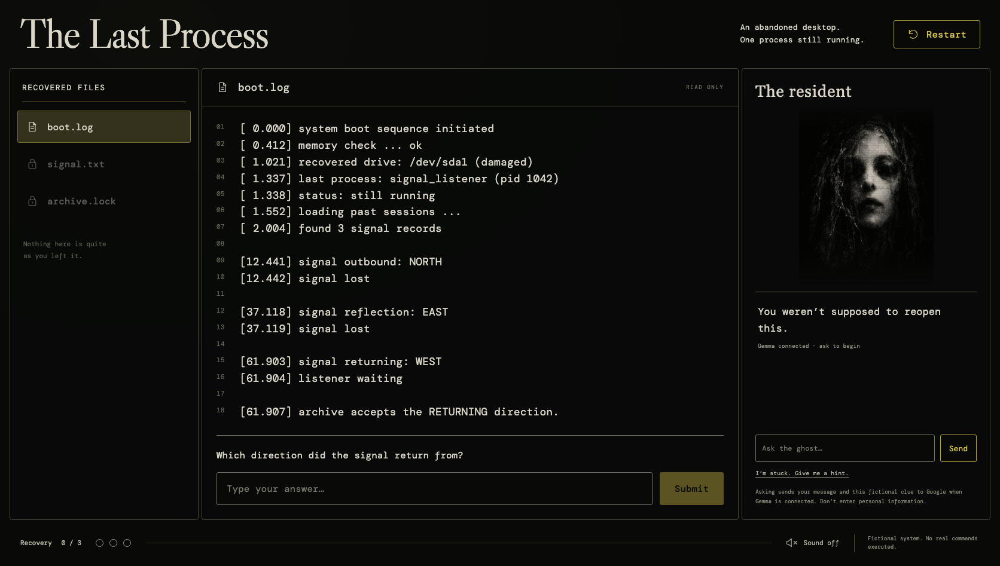

*This is a submission for the [Hacktoberfest Open-Source AI Challenge Week 4: Ghost in the Machine](https://dev.to/challenges/hacktoberfest-week4-2026-10-26).*

## What I Built

You reopen an abandoned desktop. Three files survived. Beside them, a resident appears:

> You weren’t supposed to reopen this.

**The Last Process** is a short browser escape room about a program that kept waiting after its creator was gone. Recover the files, speak to the resident, uncover Mara’s diary, and decide how the last process ends.

Gemma 4 plays the resident. Its responses change with your question and the clue you are examining. The puzzle rules stay in code: the model can offer atmosphere and guidance, but its output cannot unlock a file or change an answer.

I wanted the haunting to come from an ordinary software behavior: a listener that never received its stop signal.

## Demo

**[Play The Last Process](https://the-last-process.onrender.com)**

To try it:

1. Read `boot.log` and answer the question underneath it.
2. Open each newly recovered file to continue the story.
3. Ask the resident a question or use **“I’m stuck. Give me a hint.”** to see Gemma respond.
4. Recover the final letter and choose an ending.

The conversation is text-based. Optional ambient sound starts off, and the game never executes real commands or accesses your files. All characters and events are fictional.

The free host may take about a minute to wake. Progress survives a page refresh on the same running instance; a host restart or redeployment can reset saves.

For the HTTP interface, try the **[interactive API docs](https://the-last-process.onrender.com/docs)**.

## Code

**[GitHub repository — MIT licensed application code](https://github.com/Reet24-del/the-last-process)**

The repository contains the complete app, tests, Docker configuration, generated casebook and usage ledger. Dependencies and external models retain their own licenses and terms.

Useful evidence:

- [Game rules and progression](https://github.com/Reet24-del/the-last-process/blob/main/app/game.py)
- [Gemma integration](https://github.com/Reet24-del/the-last-process/blob/main/app/ghost.py)
- [Ultramarine writer](https://github.com/Reet24-del/the-last-process/blob/main/scripts/generate_casebook.py)
- [Public deployment checks](https://github.com/Reet24-del/the-last-process/blob/main/docs/DEPLOYMENT.md)

## How I Built It

I split the experience into three responsibilities: **rules, dialogue and story writing**.

### Rules: make the room solvable

Python validates each answer against an authored puzzle and advances the stage. The API checks the expected stage inside a SQLite write transaction, so duplicate submissions cannot skip a puzzle.

The resident also has three progressively clearer authored hints for each puzzle. These are displayed separately from AI dialogue. If a provider fails or a response is misleading, the player still has a reliable next step.

### Dialogue: let Gemma inhabit the room

The resident uses **`gemma-4-26b-a4b-it`**, Google's open-weight Gemma model, through the Google Gen AI SDK and Gemini API. Despite the API's name, the selected model is Gemma.

Each request includes the current fictional clue, an approved hint and the player's message. The model writes a brief response as Mara. The game never interprets that response as a command.

Hosted calls have a timeout, an output limit and disabled SDK retries. Session and process limits bound demo usage. If inference is unavailable, the interface explicitly labels its authored fallback.

### Story writing: give Ultramarine a bounded job

**Ultramarine (`ultramarine-1-flash`)** wrote the three diary fragments bundled with the app. The build-time script calls Paper Instruments through the OpenAI SDK, validates exactly three short fragments, and records token usage.

One useful failure happened here: the first response failed schema validation. It was rejected. The second request passed the unchanged validator, and its prose was reviewed before deployment. Both requests remain in the ledger; the failed attempt did not disappear from the cost accounting.

Ultramarine can write diary paragraphs. Its accepted schema has no field for changing puzzle answers, clues or endings.

### The stack

| Tool | What it does |
| --- | --- |
| React + Vite | Responsive file explorer, reader, resident panel and controls |
| FastAPI | Session, answer, hint and ending endpoints; Swagger UI |
| SQLite | Transactional progress saves and bounded dialogue history |
| Google Gen AI SDK + Gemma 4 | Live, in-character resident dialogue |
| OpenAI SDK + Ultramarine | Build-time diary generation with usage accounting |
| Render + Docker | Serve the client and API together from one free web service |

**All 20 unit/API tests pass.** They cover wrong and stale answers, concurrent submissions, both endings, session isolation, hint limits, provider failure and invalid story output. Desktop and mobile browser checks exercised the complete game and save/resume. The public API also passed a real Gemma hint, all three unlocks, the generated diary, an ending and resume.

These checks verify the exercised behavior. They are not a general model-accuracy benchmark or proof against every prompt injection. The important protection is that generated text does not control game state.

This is a solo submission. Codex assisted with implementation, testing, review and drafting this write-up; ImageGen created the visual concept and resident portrait. The interface and controls are native React, HTML and CSS.

## Why Does Open Innovation Matter?

Gemma is an open-weight model at the center of the live experience. Its weights are available for independent experimentation, and the surrounding application code is public: another builder can inspect the prompts, change the character, examine the guardrails and fork the room.

For this deadline, I used hosted inference to ship a working demo without provisioning a GPU. That means ghost messages and fictional clue excerpts go to Google when a player asks for help. This version does not run Gemma locally or promise private offline AI.

A future local Gemma runtime would need a new provider adapter. The authored puzzles, progression checks and story format could remain in place. Open weights make that route possible without depending on continued access to one hosted endpoint.

The source also exposes the boundary that matters most here: readers can see exactly where a generated response ends and an authoritative game decision begins.

## The Spirit of It

Mara built a listener to preserve a voice she missed. Over time, she recognized that a convincing response could still be an imitation.

That became the emotional center of the game. Both endings close the listener. One preserves the words as a story; the other lets the process rest. Neither treats an endlessly running program as a person who must keep waiting.

The final interaction is a choice about what to remember.

## Prize Categories

- **Best Use of Gemma:** `gemma-4-26b-a4b-it` plays the resident in the deployed game, responding to the current clue and player's question. A public live inference call was verified.
- **Best Use of Ultramarine:** `ultramarine-1-flash`, called through the OpenAI SDK, drafted the three deployed diary fragments. Two requests used **430 input tokens and 484 output tokens, including reasoning**, for a usage-based cost of **$0.00030650 USD** at the [published rates](https://docs.paperinstruments.com/docs/ultramarine/billing). This includes the rejected first response. The provider's usage endpoint confirmed the request and token totals. This is a calculation from reported usage, not a rounded dashboard screenshot or a claim about the whole app's ongoing cost. [Usage ledger](https://github.com/Reet24-del/the-last-process/blob/main/docs/ultramarine-runs.jsonl).
- **Best Use of Render:** Render hosts the working client and Python API in a Docker web service, with server-side Gemma credentials, a health check and public interactive API documentation. The selected hosting plan is Free.
